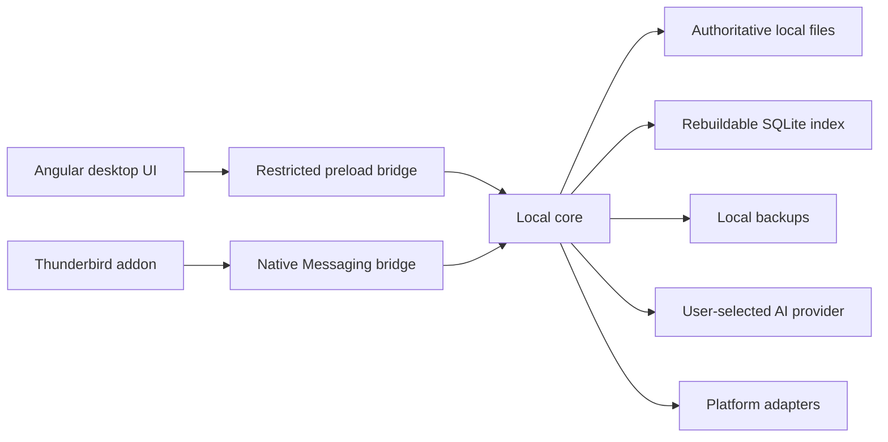

# 架构草案

状态：T01 设计草案，尚无实现。相关需求见 [需求规格](requirements.md)。

T03 实施补充：core/library.ts 为独立于 Electron/Angular 的单写入核心；desktop/library-ipc.ts 授权和转发桌面操作，Angular NoteWorkspace 串行保存并保留失败草稿。文件提交同步执行，正文暂限 2 MiB；列表当前从权威文件读取以验证完整性，SQLite 派生目录同时维护。大库检索／分页优化属于 T05。正常退出先让 UI 完成保存，失败时默认取消退出；隐藏窗口不释放编辑会话。

## 模块职责

| 模块 | 职责 | 边界 |
|---|---|---|
| Electron 主进程 | 窗口、托盘、应用生命周期、安全 preload 入口 | 不将 Node.js 和任意 IPC 暴露给页面 |
| Angular UI | 文件夹树、列表、编辑器、AI 面板、设置 | 不直接读写笔记文件或保存凭据 |
| Quill 适配层 | 编辑状态、格式转换、撤销、编辑器生命周期 | 不成为存储或搜索的数据模型 |
| 本地核心 | 权威文件、索引、版本、编辑锁、加密、备份、AI | 与 Angular、Thunderbird API 解耦 |
| Native Messaging 桥接 | 转译 addon 请求、建立受限本地连接 | 不拥有核心或桌面进程生命周期 |
| Thunderbird addon | Spaces 入口、浏览、搜索、预览、删除、编辑定位、标签映射 | 无独立笔记库，不直接修改文件 |
| 平台适配层 | 凭据保护、路径、单实例、进程启动、桥接注册、安装 | Windows 逻辑不渗入共享业务代码 |

建议工程分为 desktop、core、thunderbird、native-bridge、shared-contracts、platform、测试和文档。T02 决定实际工作区工具及路径；T01 不创建空代码骨架。

## 进程与生命周期

1. 本地核心使用当前用户权限，为每个打开的笔记库提供单写入者协调。
2. UI 窗口关闭后核心可留在后台；退出命令明确结束后台。
3. addon 首次连接可按需启动核心，但核心必须独立于 Native Messaging 宿主的退出生命周期。
4. 关闭 Thunderbird 只关闭桥接连接，不终止独立应用和正在保存的操作。
5. 本地进程之间采用受限 IPC；Windows named pipe 或其他方式在 T02 选定并验证，不默认开放无鉴权 TCP 端口。
6. addon 与核心断连时显示真实状态。重新连接重新握手并核对变更游标；游标失效时全量刷新可访问内容。
7. 操作系统休眠或进程异常后，编辑会话重新校验。旧会话失效，不允许迟到写入覆盖新会话内容。

T02 必须用最小原型证明第 3、4 项。不能只通过“创建子进程成功”推断关闭 Thunderbird 后不会被系统终止。

## 操作顺序

### 保存

校验身份与编辑权限 → 校验会话和预期版本 → 转换并验证内容 → 写入新修订临时文件 → 刷盘与提交权威版本 → 更新派生索引 → 发布变更事件。

权威文件提交成功但索引失败时，返回“内容已保存，索引待修复”的明确状态，安排重建；不能误报成完全未保存后让客户端重复覆盖。原子替换及断电持久性依赖文件系统和平台，T03 必须通过中断场景验证实际边界。

### 删除

在同一串行化操作内校验权限、预期版本及编辑锁，再移入回收站并更新索引。文件夹批量删除先检查整个子树；存在受限或编辑中笔记则整体失败，不能只删一半。

### 搜索与预览

以调用者可信身份计算可见范围 → 排除回收站和被隐藏记录 → 排除锁定内容 → 执行搜索／读取 → 再次核对权限与版本 → 返回结果。

addon 的过滤不能只靠 Angular 或 addon 页面。派生统计、事件和旧游标同样不得泄露受限笔记的标题、摘要或内容。

### AI 处理

用户选择提供商、模型、操作范围 → 核心获取指定正文版本 → 必要时提示加密内容出站 → 发起可取消请求 → 生成预览 → 用户应用结果 → 再校验当前版本及编辑会话 → 走统一保存流程。

AI 返回时笔记已修改、删除、锁定或编辑会话结束，不能自动写入。摘要生成也记录来源正文版本。

## 安全与内容处理

- Electron 启用进程隔离与受限 preload，按锁定版本采用合适的沙箱配置；渲染进程不持有密钥。
- HTML 与 Markdown 预览清理脚本、事件处理器和危险 URL。远程图片不默认加载，外链由用户操作后经允许的系统入口打开。
- 不把笔记直接作为可执行页面加载；清理显示内容与保存原始内容是两个步骤，不得借清理静默毁损原文。
- 附件路径必须解析在授权笔记库内，拒绝目录穿越和越界链接。实际文件访问不接受任意客户端绝对路径。
- 凭据与笔记库密码分离。AI token／API Key 使用平台保护存储，不进入笔记备份或日志。
- 本地通信通过受限端点和可信握手确定客户端权限，不能相信请求中的客户端类型字符串。
- 普通用户权限即可运行后台；第一版不引入系统级服务。

## 平台与发布

Windows 10 x64 为首版最低平台目标，Thunderbird 157.0.1 为固定 Release 基线。T02 记录实际 Windows build、Thunderbird、Electron、Node.js、Angular 和 TypeScript 版本；T15 才能形成已测试支持矩阵。

macOS／Linux 以后分别适配凭据存储、应用生命周期、桥接注册和分发，不能因业务代码可复用就声明已经支持。
